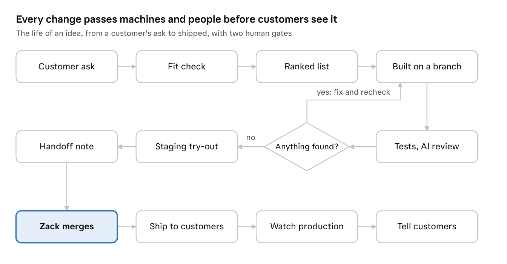

# How Eventually gets built: our two-person software factory

Eventually is built by two people, Kelsey and Zack, with AI doing most of the typing and people making every call that matters. There is no engineering team behind us. What we have instead is a handful of AI helpers, each with a narrow job, and a process that keeps their work honest.

People keep asking how that works, so this is the plain version as it stands today. It changes almost every week, so treat it as a snapshot rather than a manual.

The short version: every change is written by an AI session, checked by machines, read by a second AI looking for bugs, tried on a practice copy of the app, and handed to a person. Only a person merges it, and only a person ships it to customers.

## Who does what

Kelsey owns what we build, Zack owns how it gets built and shipped, and the AI helpers do the legwork in between. Zack put the split this way: let him manage the process so Kelsey can focus on product.

| Who | What they do | What they leave to others |
| --- | --- | --- |
| Kelsey, co-founder | Decides what customers need and how it should look and feel. Builds features with her own AI sessions, tries them out, and hands each one over with a written note. | Git, test setups, servers and deploys. The tooling is built so she never has to touch them. |
| Zack, co-founder | Builds and tends the factory itself. Runs several AI coding sessions at once, reviews every change, merges it and ships it to customers. | Day-to-day product and design calls, which are Kelsey's. |
| AI coding sessions | Claude Code, an AI that reads and edits our codebase. Writes the code, the tests and the docs, fixes what reviewers find, and leaves a short note on every save explaining why. | Merging and shipping. A session prepares work; a person decides it's done. |
| AI reviewers | Claude Review, our own bug hunter built on Claude, reads every change. Greptile, an outside AI reviewer, gets a second look at anything touching payments, sign-in or syncing with Squarespace. | Approving anything. Their findings have to be fixed or answered before a change can go in. |
| Scheduled helpers | Small AI routines that run on a timer: watching production health, giving new bug reports a first read, sweeping open issues overnight, and drafting the weekly customer update. | Changing anything in production. They report; people act. |
| A chief-of-staff assistant | Claude in a chat app, working for Zack. Keeps one ranked list of priorities, notices when someone is waiting on him, and drafts replies he sends himself. | Sending anything in his name. |

## The life of an idea

An idea becomes shipped software in ten steps, and only two of them have to be Zack: the merge and the deploy.

Anything the checks or the reviewer find loops back to the AI session that built it, and the change goes round again until it comes back clean.

1. **Customer ask.** A request, a bug report or one of our own ideas becomes an issue in GitHub, the shared to-do list for our code.
1. **Fit check.** A helper gives it a first read against who we build for and labels it green, yellow or red. It's advice; we can overrule it.
1. **Ranked list.** It joins one ranked list of everything, and the single most important item is pinned as next up.
1. **Built on a branch.** An AI session, working with Kelsey or Zack, builds it on its own branch, a private copy of the code, so nothing touches the live app while it's in progress.
1. **Tests and AI review.** Every save runs the checks in the background. When the work is ready, the AI reviewer reads it for bugs.
1. **Staging try-out.** The change goes onto the practice copy of the app and gets clicked through in a real browser, at desktop and phone sizes.
1. **Handoff note.** The author writes what the work was for, what was checked and where, and what's still uncertain, then labels it "Ready for Zack".
1. **Zack merges.** He reads the change and the note and merges it into the main code.
1. **Zack ships to customers.** He runs the deploy himself. The full test suite runs once more, then it goes live.
1. **Watch and tell.** Health checks watch for trouble, and Friday's update tells customers what got better.

## The safety rails

AI makes it cheap to write code, so the work moved to checking it. These are the rails every change runs on.

- **A person merges every change.** AI sessions write and fix; Zack is the one who merges and ships. Nothing reaches customers on a machine's say-so.
- **One change at a time.** We finish and merge one change before pushing the next one through review, so nothing half-done piles up and the machines doing the checking don't get overloaded.
- **Machines check before people do.** Every save kicks off the tests, style checks and security scans in the background, and the change shows a green or red light. A change can't be marked ready until the full test suite has passed on its exact final version.
- **A second set of AI eyes, held to a proof standard.** The AI reviewer reads every change for bugs. A finding only blocks if it comes with a failing test or a way to reproduce it, except anything about security, money or lost data, which always blocks.
- **Riskier changes get more scrutiny.** Each change gets an automatic risk score from what it touches. Payments, sign-in and syncing get a stronger review and an outside reviewer, and the riskiest changes need a real walk-through on the practice copy, not just a note saying it was fine.
- **Practice copy first.** Staging is a full copy of the app on its own server. Anything that depends on how a customer's real site looks gets judged there, because judging a design against made-up test data once cost us a full day.
- **A checklist nobody can skip.** The "ready to merge" label can only be applied by a script that re-checks every step: reviews green, tests green, notes written, follow-ups filed. It exists because the label used to be the last line of a long checklist, which made it the easy line to jump to.
- **Saving work is never blocked.** Checks warn instead of refusing, so finished work always gets backed up and seen. A blocked save once left a full day of finished work stuck on one laptop for ten hours.
- **Watching after it ships.** The whole test suite runs again right before each deploy, and once it's live, health checks keep an eye on errors, slow pages and background jobs.

## The daily and weekly rhythm

Most of the routine runs on a timer, so the two of us spend our attention on decisions rather than chores. Helpers stay quiet when everything is fine and speak up only when something needs a person.

| When | What happens | Who |
| --- | --- | --- |
| Every save, often hourly | Work is backed up, checks run in the background, and a short note records why the change was made | The AI session doing the work |
| Every hour | Each new issue gets a first-pass verdict on whether it fits who we build for: green, yellow or red | Scheduled helper |
| Every few hours | Production health check. It posts to our health channel in Slack only when something is worth acting on | Scheduled helper |
| Several times a day | A check on which work is waiting on Zack, so nobody sits blocked | Chief-of-staff assistant |
| Overnight | A triage pass over new errors and a sweep of open issues, which can turn small fixes into changes ready for review in the morning | Scheduled helpers |
| Each morning | One ranked list and a single pinned "next up" | Chief-of-staff assistant, then Zack |
| Mondays | Batched library and security updates, and a look at which review step actually caught bugs last week | Zack, with AI help |
| Fridays | A plain-language summary of what got better for customers that week, written from what shipped | Scheduled helper, posted to Slack |

## The skills and scripts we lean on

Most of the factory comes down to a dozen or so short commands, so neither of us has to remember the steps. They come in two kinds:

- **Skills** are written playbooks. One of us types a short command like /save, and the AI session follows the playbook behind it, step by step.
- **Scripts** are small programs that do one job exactly the same way every time, with no AI judgment involved.

The working day is five skills, and only the last one is a ceremony. The "Where it fits" column matches the steps in the flow chart above.

| Skill | What it does for us | Where it fits |
| --- | --- | --- |
| /begin | Starts a piece of work: loads our design rules and any related issues, gives a quick verdict on whether it fits our focus, and opens a private branch | Built on a branch |
| /save | Backs up the work, pulls in the other person's latest changes and writes the "why" note. It takes about three seconds, so we run it constantly | Built on a branch |
| /qa | Opens a real browser and clicks through whatever changed, at desktop and phone sizes, then reports anything that breaks our design system | Staging try-out |
| /done | Writes the handoff note, runs an independent audit, deals with what it finds, and only then labels the work Ready for Zack | Handoff note |
| /wrap | The closing ceremony: changelog entry, session write-up, follow-ups filed as issues, and the final checklist | Zack merges |

A few more skills do the thinking work around the code:

| Skill | What it does for us | Where it fits |
| --- | --- | --- |
| /fit | Judges an idea, a plan or a finished change against who we build for, and answers green, yellow or red with its reasons | Fit check |
| /fac | Short for feature acquisition cost. Runs a customer's feature request through nine questions, from how hard it is to whether a workaround already exists, and recommends build, workaround, later, ask first or decline | Fit check |
| /next | Tidies our status board and pins the single most important next step | Ranked list |
| /audit | Sends several AI reviewers over a change at once, looking for security holes, bugs, missing tests and design slips. It reports and never fixes | Tests, AI review |
| /release-news | Turns a feature that just went live into a blog post and social posts, written from our marketing guide so the voice stays consistent | Tell customers |

And the scripts that hold it together:

- **doctor** repairs a laptop whose setup has drifted, in the background, and stays silent when everything is healthy.
- **test-check** runs the full set of tests and checks, and stamps the exact version it checked as green.
- **review** runs our AI reviewer on a change and records its verdict where everyone can see it.
- **ready-to-merge** is the checklist nobody can skip. It re-checks every step and only then applies the label.
- **board-sync** keeps the status board honest by recording the facts nobody writes down at the time: what merged, what shipped, what closed.
- **stage-yield** counts, every Monday, which step actually caught bugs the week before.

The scheduled helpers in the rhythm table are skills too, run on a timer instead of by hand.

## How we stay careful about security

We keep the details of our security setup private, but the habits behind it are worth sharing, because most of them cost a small team very little once they're automated.

- **Security checks on every change.** The same automatic run that tests a change also scans it for common security mistakes and for known problems in the code libraries we build on.
- **Security findings always block.** Before a change is handed over, an independent AI audit looks for security holes along with bugs. Most findings need proof before they can hold a change up, but anything touching security, money or lost data has to be dealt with before merge, no matter what.
- **Library updates on a clock.** When a security advisory lands for a library we use, it gets a due date by severity: the most serious the same day, moderate ones within a week, and the rest in a Monday batch.
- **Privacy docs move with the code.** If a change adds an outside service, sends new personal information to one, or stores something in a visitor's browser, the merge checklist flags it so our privacy documents get updated in the same change.
- **Watching for trouble.** The regular health checks on the live app include signs of attack, not just errors, and speak up only when something looks off.
- **A rehearsed recovery plan.** Once a year we restore the live database from backup onto a separate copy, check that it works in a browser, and tear it down again. We ran the first full rehearsal this month.
- **People hold the keys.** AI sessions prepare the work, but a person merges every change and a person ships it.

## It keeps changing

Most of the rails above were added as we learned what the factory needed. A blocked save stranded a day of work, so saving can't be blocked. An outside bug-finding service got too expensive, so we built our own reviewer. Our hosted test minutes ran out every month, so the checks moved onto our own laptops and report back to GitHub, where we track the code.

A few things have held steady through all of it:

- **Write down why, not just what.** Every save carries a note, and every handoff says what was checked, where, and what's still uncertain. The next person, or the next AI session, reads it instead of guessing.
- **Machines repeat, people decide.** Anything that runs on a schedule reports; nothing on a schedule changes production by itself.
- **Cut what doesn't earn its keep.** We count which steps actually catch bugs, and a step that never does gets questioned.

Ask us again in a month and some of this will have moved. That's the point: the factory is a product too, and we keep shipping it.
